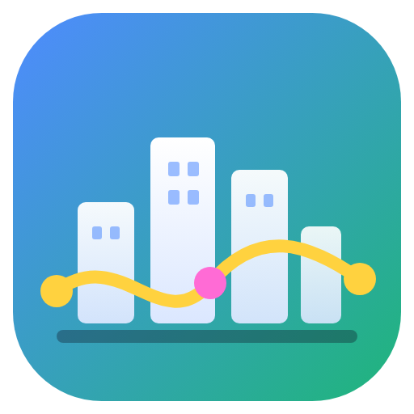

<p align="center"></p>

# Flowcity — construis ta ville, automatise ta vie

Flowcity est un **jeu bac à sable façon SimCity** pour apprendre à créer des **automatisations (workflows)** et organiser sa vie numérique pour de vrai.

Au lancement, tu te connectes avec ton **compte Google** et la carte est **vide** : rien n'est construit à ta place, tu bâtis tout de zéro. Chaque bâtiment branche ta ville sur un outil réel (la Poste = Gmail, les Archives = Google Drive, le Beffroi = Google Agenda, la Tour radio = notifications sur ton téléphone…). Les routes relient les bâtiments : quand une automatisation est en marche, **ses données circulent en flux lumineux** d'un bâtiment à l'autre.

Quelques exemples d'usage, selon le profil :
- **Organiser ses mails** : ranger les newsletters dans un dossier, alerte sur ton téléphone quand un proche écrit, factures enregistrées dans le Drive.
- **Chercher un emploi** : alerte sur les nouvelles offres, journal des candidatures dans une Google Sheet, brouillons de relance après 7 jours, l'IA repère les réponses des recruteurs.
- **RH et recrutement** : tri des CV reçus (pièce jointe dans le Drive, nom, poste et expérience extraits par l'IA, accusé de réception), entretiens du jour envoyés sur Slack, arrivée d'un nouveau salarié.
- **Informatique** : surveillance d'un site toutes les 15 minutes, mails de bug transformés en issues GitHub, nouvelles versions publiées sur Discord, webhooks.
- **Réseaux et communauté** : nouvelle vidéo YouTube relayée sur Discord et Telegram, un article de blog transformé en post LinkedIn par l'IA.
- **Vie perso** : météo du matin, rappel avant chaque rendez-vous, mails étoilés transformés en tâches, maison connectée.

## Comment on joue

1. **Connexion Google** : donne d'emblée accès à Gmail, Drive, Agenda et Sheets (sans jamais partager ton mot de passe). Tu peux aussi « visiter sans compte » : tout se fait alors en simulation.
2. **Carte vide** : choisis (si tu veux) ce qui t'intéresse — mails, emploi, RH, informatique, réseaux, vie perso — et les bâtiments utiles sont marqués d'une ★. Puis construis : la Mairie d'abord, puis ce que tu veux.
3. **Construire** (barre du bas) : bâtiments classés par usage — Essentiels, Communication, Fichiers & organisation, Tri & intelligence, Web & réseaux, Vie réelle, Sécurité & suivi, Sur mesure, Décor. Clique, pose sur la carte (R pour pivoter), trace des routes en clic-glissé, démolis avec le bulldozer.
4. **Relier des bâtiments** (bouton en haut) : c'est comme ça qu'on crée une automatisation, sans schéma ni jargon.
   - clique sur le bâtiment qui donne le **départ** (il brille) : la Poste → « quand je reçois un mail », la Mairie → « quand c'est l'heure »… ;
   - clique sur le bâtiment qui doit **agir** : la Tour radio → « m'envoie une notification sur mon téléphone », les Archives → « enregistre le fichier »… ;
   - une bulle pose des questions simples (« De qui ? », « Avec quel mot ? », « Quel message ? »). Les informations de l'étape d'avant s'insèrent d'un clic, comme `[Expéditeur]` ou `[Objet]` ;
   - **Terminer** → l'automatisation est racontée en phrases (« Quand je reçois un mail de maman → la Tour radio m'envoie une notification »). On peut l'**essayer** sans rien envoyer, puis la **mettre en marche**. Un ruban lumineux relie alors les bâtiments : les données y circulent.
5. **Mes automatisations** : la liste, avec interrupteur marche/arrêt, Essayer, Lancer maintenant, Modifier. Un **mode avancé** (éditeur en schéma, avec aiguillages et formules) reste disponible pour les curieux, mais il n'est jamais nécessaire.
6. **Balade** : visite ta ville à pied (ZQSD / WASD, souris, Maj pour courir) et entre dans un bâtiment avec **E**. Touche **V** pour passer de la vue d'ensemble à la balade. Pas d'armes : on se promène.

7. **Habitants** (bouton 👥 en haut, ou la Mairie) : ajoute des personnes à ta ville avec leur adresse Google et donne-leur un rôle.

Le mode **bac à sable** (par défaut) débloque tout gratuitement. Le **mode défi** (à la Mairie) ajoute crédits, niveaux et impôts quotidiens.

## Habitants et rôles

Chaque ville a un **Créateur** (celui qui l'a fondée : tous les droits, pour toujours). On y ajoute des personnes avec un rôle :

| Rôle | Ce qu'il permet (par défaut) |
|---|---|
| 👑 **Créateur** | tout |
| 🧭 **Gestionnaire** | construire, créer et modifier les automatisations, les lancer, brancher des comptes, gérer les tâches, ajouter des personnes |
| 🙂 **Membre** | visiter, lancer et mettre en marche les automatisations, gérer les tâches |

On crée **d'autres rôles** en deux clics (nom, emoji, couleur) en cochant des droits écrits en français : construire ; créer/modifier des automatisations ; les lancer ; brancher des comptes ; gérer les tâches ; ajouter des personnes ; créer des rôles ; régler la ville. Les droits des rôles Gestionnaire et Membre se modifient aussi.

Règles de sécurité : on ne peut donner que des droits qu'on a soi-même ; personne ne peut retirer ni rétrograder le Créateur ; supprimer un rôle fait redevenir Membres les personnes concernées. Les droits sont vérifiés par l'application elle-même (pas seulement par l'interface).

Pour entrer dans une ville où l'on a été ajouté : se connecter à Flowcity avec son compte Google sur le même ordinateur (le nom de la ville, en haut à gauche, permet de changer de ville), ou ouvrir le fichier de la ville envoyé par son créateur (Mairie → Sauvegarder / Ouvrir une ville). Le partage en direct entre plusieurs ordinateurs demandera un serveur commun : c'est la prochaine étape.

## Les bâtiments

| Catégorie | Bâtiments |
|---|---|
| 🏛️ Essentiels | **Mairie** (tableau de bord, tâches, journal, mode de jeu, sauvegarde), **École** (18 missions pour apprendre : déclencheur → action, variables, planification, conditions, IA, webhooks, gestion des erreurs, validation humaine…), **Centrale électrique** (tous tes comptes et clés, chiffrés), **Bibliothèque** (26 recettes prêtes à l'emploi, glossaire), **Ta maison** (tâches, bloc-notes) |
| ✉️ Communication | **La Poste** (Gmail : nouveau mail, recherche, envoi, réponse, brouillon, rangement dans des dossiers, pièces jointes), **Café des messageries** (Slack, Discord, Teams, e-mail), **Tour radio** (ntfy, Telegram, WhatsApp, SMS) |
| 🗂️ Fichiers & organisation | **Archives** (Google Drive), **Cadastre** (Google Sheets), **Beffroi** (Google Agenda), **Bureau des projets** (Notion, Trello, Todoist, Airtable, Outlook) |
| 🧠 Tri & intelligence | **Centre de tri** (conditions oui/non, filtres, dates, préparation de champs, limites, pauses, regroupement, formules, *demander mon accord*), **Laboratoire IA** (Claude, OpenAI, Mistral : demander, classer, extraire — et l'assistant Claude qui t'aide à construire tes automatisations) |
| 🌐 Web & réseaux | **Gare** (webhooks entrants), **Tour des développeurs** (n'importe quelle API, vérification de site, GitHub, RSS), **Studio média** (YouTube, préparation de posts pour les réseaux, Spotify), **Usine** (envoyer des données à n8n, Make, Zapier) |
| 🏡 Vie réelle | **Maison connectée** (Home Assistant, météo), **Banque** (Stripe) |
| 🛡️ Sécurité & suivi | **Caserne** (erreurs expliquées, relance, alerte en cas d'erreur), **Hôpital** (bilan de santé des connexions et des automatisations), **Commissariat** (règles de prudence, automatisations qui agissent pour toi), **Observatoire** (statistiques, temps gagné) |
| 🛠️ Sur mesure | **Atelier modulable** (choisis la fonction et la couleur), **Bureau d'architecte** (crée tes propres bâtiments : nom, emoji, forme, couleur, étages, taille, et leur fonction — une action préréglée, un appel d'API ou une automatisation entière ; on le relie ensuite comme les autres) |

## Lancer l'application

**Windows** : installe [Node.js LTS](https://nodejs.org/fr), télécharge le projet (bouton vert **Code** → **Download ZIP**), puis double-clique sur **`Lancer Flowcity.bat`**. La première fois, l'installation prend 2 à 5 minutes. Pour fabriquer un `.exe` (installeur ou version portable) : **`Creer l'exe Windows.bat`**.

**En ligne de commande** (Windows, macOS, Linux) :

```bash
npm install
npm start          # lance l'application
npm run dev        # développement (rechargement à chaud)
npm test           # tests du moteur
npm run preview    # aperçu dans un navigateur (tout en simulation)
npm run dist:win   # ou dist:mac / dist:linux
```

## Relier Flowcity à Google (une seule fois)

La connexion Google demande un identifiant d'application (gratuit) :

1. [console.cloud.google.com](https://console.cloud.google.com/projectcreate) → crée un projet.
2. *API et services → Bibliothèque* : active **Gmail API**, **Google Drive API**, **Google Calendar API** et **Google Sheets API**.
3. *Écran de consentement OAuth* : type **Externe**, puis ajoute les adresses des utilisateurs dans *Utilisateurs test* (tant que l'application n'est pas validée par Google).
4. *Identifiants → Créer des identifiants → ID client OAuth* → type **Application de bureau**.
5. Colle l'ID client et le code secret dans l'écran de connexion de Flowcity.

Pour une équipe ou une école, copie `flowcity.config.example.json` en `flowcity.config.json` (à côté de l'application) avec ces deux valeurs : personne n'aura à le faire.

Les autres services se branchent à la **Centrale électrique**, avec l'aide pas à pas de chacun (jeton, clé ou adresse de webhook). Les secrets sont chiffrés par le système (DPAPI sous Windows, Trousseau sous macOS) et ne quittent l'ordinateur que vers le service concerné.

## Comment ça marche

- Une **automatisation** (un « workflow ») est une suite d'étapes. Le déclencheur produit des *éléments* (un mail, une ligne, un fichier…) ; chaque étape les traite un par un, et ses résultats s'ajoutent à l'élément : après « Demander à Claude », tu peux utiliser à la fois `[Objet]` (du mail) et `[Réponse de l’IA]`.
- Les déclencheurs « nouveau mail », « nouveau fichier », « événement qui approche », « nouvel article » vérifient régulièrement s'il y a du nouveau (5 à 30 minutes) et ne traitent jamais deux fois le même élément.
- La **Gare** écoute sur `http://127.0.0.1:47800/hook/<nom>` : un formulaire ou un autre outil de ton ordinateur peut démarrer une automatisation.
- Les automatisations tournent quand Flowcity est ouvert.

## Architecture

```
electron/
  main.cjs        fenêtre, session Google, ville (état de référence), exécution, planificateur, Gare
  google.cjs      OAuth bureau (PKCE) + Gmail, Drive, Agenda, Sheets
  connectors.cjs  exécution réelle de chaque étape (Slack, Discord, Telegram, Notion, IA, HTTP…) + tests de connexion
  assistant.cjs   assistant Claude du Laboratoire IA (propose des workflows, créés avec ton accord)
  store.cjs       stockage local + secrets chiffrés
  preload.cjs     pont sécurisé vers l'interface
shared/           (utilisé par l'application ET l'aperçu navigateur)
  services.mjs    catalogue des services : déclencheurs, actions, champs
  simple.mjs      mode simple : phrases, étiquettes [Objet], champs simplifiés
  people.mjs      habitants, rôles et droits
  buildings.mjs   bâtiments, catégories, niveaux
  engine.mjs      moteur d'exécution, variables, conditions, vérifications
  city.mjs        état de la ville et toutes les actions (construction, routes, workflows…)
  missions.mjs    parcours de l'École
  library.mjs     recettes, profils d'usage, glossaire
  mock.mjs        données d'exemple du mode simulation
src/
  world.js        monde 3D (Three.js) : terrain, construction, routes, flux, balade à pied
  models.js       modèles 3D des bâtiments
  linker.js       « Relier des bâtiments » : création d'automatisations dans la ville
  editor.js       éditeur en schéma (mode avancé, facultatif)
  logo.js         logo Flowcity
  people.js       panneau Habitants (personnes, rôles, droits)
  panels.js       panneaux des bâtiments
  main.js         interface du jeu
  api.js          accès au processus principal (ou mode navigateur)
tests/            tests du moteur et de la ville (node --test)
```
